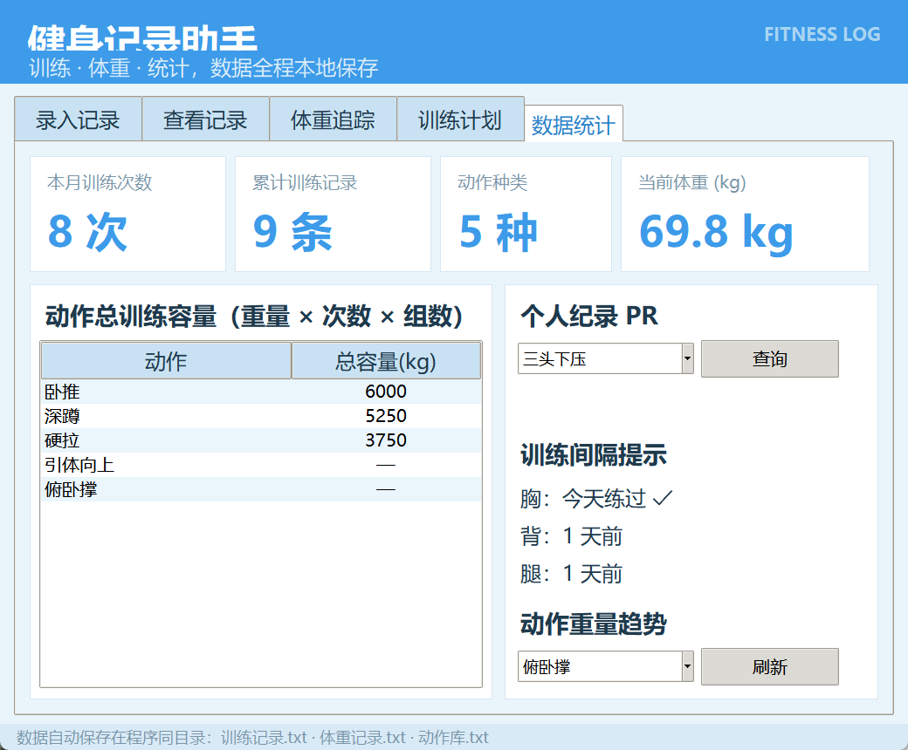

# 🏋️ 健身记录助手

一个简洁好用的 **Windows 本地健身记录软件**：淡蓝色主题，数据保存在本地 txt 文件中，关掉软件再打开也不会丢。无需联网、无需安装环境，双击即可使用。



## ✨ 功能亮点

| 模块 | 说明 |
|------|------|
| 📝 训练记录录入 | 日期、动作、组数、重量、次数、备注，一键保存 |
| 🔍 记录查看 | 查看全部记录 / 按日期筛选 |
| ✏️ 增删改记录 | 修改填错的重量次数，删除记录 |
| 🎯 动作库预设 | 卧推、硬拉、引体、划船等常用动作，下拉即选 |
| ⚖️ 体重追踪 | 每日记录体重，自动画出变化趋势曲线 |
| 🏆 PR 提醒 | 刷新个人纪录时弹窗「恭喜！刷新个人纪录」 |
| 📊 数据统计 | 本月训练次数、动作最大重量 PR、训练容量 |
| 📈 重量趋势图 | 查看某个动作的训练重量变化 |
| 🗓️ 训练计划模板 | 内置「推拉腿（Push-Pull-Legs）」三分化计划 |
| 📤 导出 CSV | 一键导出记录，Excel 可直接打开 |

## 🚀 快速开始

1. 点击右侧 **Releases**，下载最新的 `健身记录助手.exe`
2. 双击运行即可，无需安装任何东西

> 首次运行若杀毒软件提示「未知程序」，请选择「允许 / 信任」（这是 PyInstaller 打包生成的程序，安全）。

## 🛠 从源码运行（可选）

需要 Python 3.9+（自带 tkinter）：

```bash
python fitness_assistant.py
```

## 💾 数据存储

所有数据自动保存在程序同目录，共三个文件：

| 文件 | 内容 |
|------|------|
| `训练记录.txt` | 训练记录 |
| `体重记录.txt` | 体重记录 |
| `动作库.txt` | 动作库（首次运行自动生成） |

备份时把这三个 txt 文件复制到别处（如 U 盘）即可。

## 📄 更多说明

详见 [使用说明.txt](使用说明.txt)。